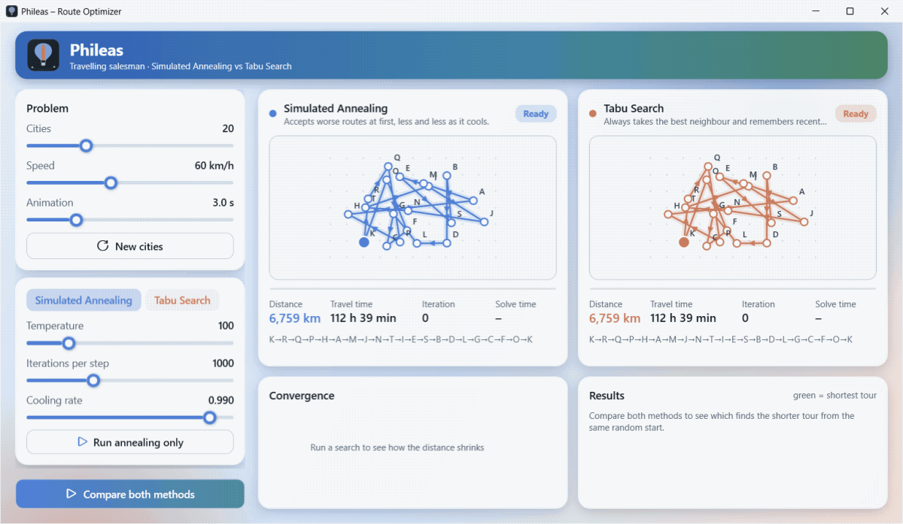
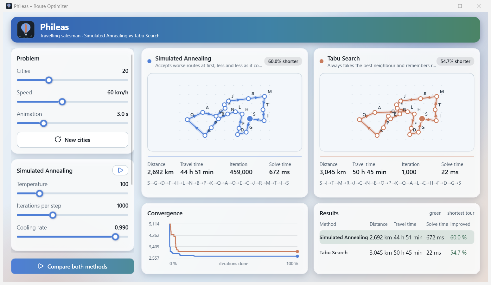

<p align="center">
  
</p>

<p align="center">
  <a href="https://github.com/NisanurBulut/TezRota/actions/workflows/dotnet.yml"></a>
  
  
  <a href="LICENSE"></a>
  <a href="https://github.com/NisanurBulut/TezRota/releases"></a>
  &nbsp;⭐ <b>Like it? Give it a star!</b>
</p>

<p align="center">
  
</p>

Phileas takes random cities, builds one random tour and lets two metaheuristics improve it. You see both routes
shrink side by side, with distance, travel time at a chosen speed, iteration counter, solve time, a convergence
chart and a result table that marks the shortest tour.

It is the modern rewrite of my master's thesis application (*TezRota*, 2019, WinForms) on Simulated Annealing, Tabu Search and routing.
The original application is kept in this repository.

## Features

- **Two solvers** with the thesis defaults: Simulated Annealing (temperature 100, 1000 iterations per step, cooling rate 0.99) and Tabu Search (tabu list 3, 12 neighbours, 1000 iterations).
- **Same problem for both**: same cities, same random start tour, so the comparison is fair.
- **Live visualisation**: the recorded search is replayed with adjustable speed; animated route, pulsing start city, progress bar, convergence chart.
- **Responsive**: solving runs on a background thread and can be cancelled.
- **Adjustable**: number of cities (5–60), speed (km/h), all solver parameters via sliders.



## Getting started

Requires Windows and the [.NET 10 SDK](https://dotnet.microsoft.com/download).

```bash
dotnet run --project src/Phileas.Wpf
dotnet test Phileas.sln
```

## Solution layout

| Path | Content |
|---|---|
| `src/Phileas.Core` | The algorithms and models. Class library without dependencies and without UI. |
| `src/Phileas.Wpf` | WPF front end: views, ViewModels (CommunityToolkit.Mvvm), dependency injection, theme, custom controls. |
| `tests/Phileas.Core.Tests` | xUnit tests for the solvers. |
| `docs/ARCHITECTURE.md` | Design document: analysis of the legacy code, architecture, UI design, ADRs. |
| `legacy/TezRota.WinForms` | The original 2019 WinForms thesis application (.NET Framework 4.8, needs SQL Server). Kept unchanged for reference. |

Defaults can be changed in `src/Phileas.Wpf/appsettings.json`.

## How it works

Both methods start from the same random tour and repeatedly swap two cities.

- **Simulated Annealing** accepts every shorter tour and a longer one with probability `exp(-Δ/T)`; the temperature `T` is multiplied by the cooling rate after every block of iterations.
- **Tabu Search** evaluates several neighbours per iteration, moves to the best one that is not on the tabu list and remembers the last swaps so it does not walk in circles.

A solver returns in milliseconds, so it records every improvement and the UI replays the recording.
Details and trade-offs are in [docs/ARCHITECTURE.md](docs/ARCHITECTURE.md).

## Development workflow

Work happens on branches and reaches `master` by pull request. GitHub Actions builds and tests on Windows, and every merged
pull request creates a release `vMAJOR.MINOR.PATCH` (the first one was `v0.1.0`): a branch name containing `major` raises the major number,
`dev` the minor number, anything else (for example `hotfix`) the patch number.

## Zusammenfassung (Deutsch)

Phileas ist eine WPF-Desktopanwendung (.NET 10, MVVM mit CommunityToolkit.Mvvm, Dependency Injection), die das Problem
des Handlungsreisenden mit zwei Metaheuristiken löst – **Simulated Annealing** und **Tabu-Suche** – und beide Verfahren
live vergleicht: animierte Routen, Konvergenzdiagramm, Distanz, Fahrzeit und Rechenzeit. Die Algorithmen liegen in einer
UI-unabhängigen Klassenbibliothek mit Unit-Tests; die Oberfläche ist ein modernes, helles Fluent-Design ohne externe UI-Bibliothek.
Das Projekt ist die Neuimplementierung meiner Masterarbeit (WinForms, 2019). Ein .NET-MAUI-Client (Windows/Android) ist als nächste Phase geplant.

## Original Turkish documentation

The README of the original thesis application is preserved in [legacy/TezRota.WinForms/README.md](legacy/TezRota.WinForms/README.md).

## License

GPL-3.0, see [LICENSE](LICENSE).

---

<p align="center">Made with ☕ and a lot of route optimisation. If you like it, <a href="https://github.com/NisanurBulut/TezRota">⭐ star the repo</a>.</p>
