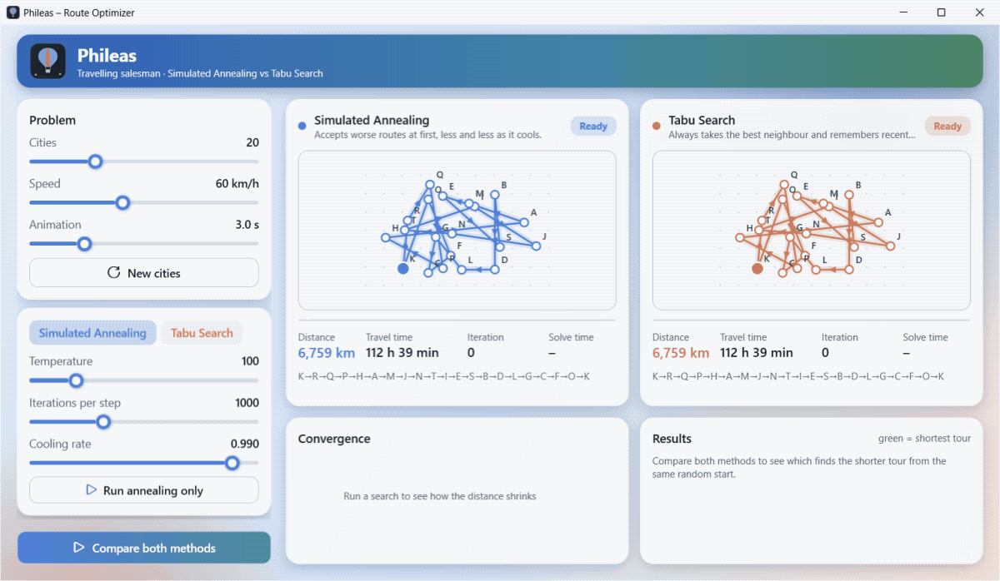
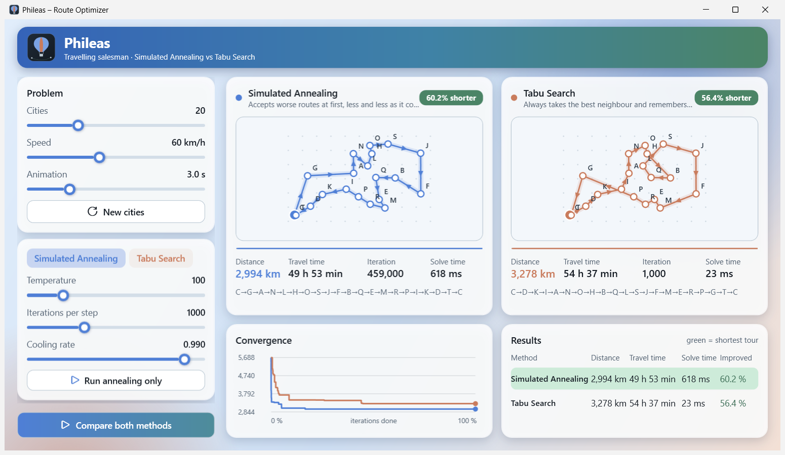
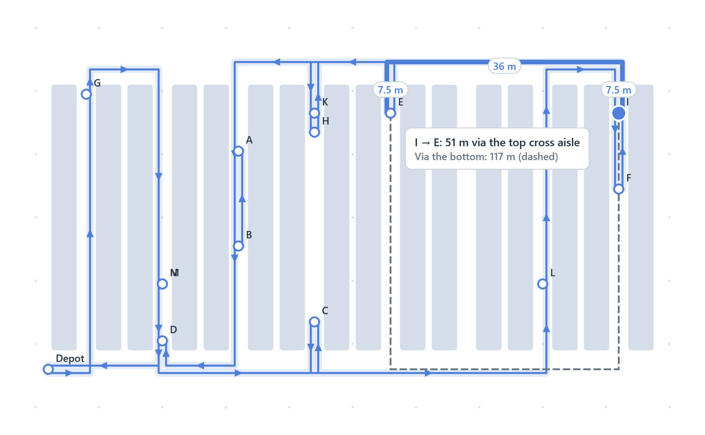

<p align="center">
  
</p>

<p align="center">
  <a href="https://github.com/NisanurBulut/TezRota/actions/workflows/dotnet.yml"></a>
  
  
  <a href="LICENSE"></a>
  <a href="https://github.com/NisanurBulut/TezRota/releases"></a>
  &nbsp;⭐ <b>Like it? Give it a star!</b>
</p>

<p align="center">
  
</p>

Phileas takes random cities, builds one random tour and lets two metaheuristics improve it. You see both routes
shrink side by side, with distance, travel time at a chosen speed, iteration counter, solve time, a convergence
chart and a result table that marks the shortest tour.

The same solvers also plan **order picking in a warehouse**: a picker starts at the depot, walks along the aisles to every
pick location and returns. Simulated Annealing and Tabu Search find a short picking route, compared side by side like the cities.

It is the modern rewrite of my master's thesis application (*TezRota*, 2019, WinForms) on Simulated Annealing, Tabu Search and routing.
The original application is kept in this repository.

## 🎩 Who was Phileas Fogg?

**Phileas Fogg** is the unflappable English gentleman from Jules Verne's adventure novel *Around the World in Eighty Days* (1872). Punctual to the second and allergic to surprises, he bets his fellow members of London's Reform Club **£20,000** that he can circle the globe in **80 days** – and leaves that very evening with his quick-witted valet **Passepartout**. 🧳

- 🚂🚢🐘🛷 **Any vehicle will do:** trains, steamers, an elephant and even a sledge – whatever keeps him on schedule.
- 🕵️ **A detective on his heels:** Inspector Fix is sure Fogg is a bank robber on the run.
- 🤫 **Spoiler:** Fogg thinks he arrived a day late, but travelling east he *gained* a day – he wins with minutes to spare!
- 🎈 **About the balloon in our logo:** it is a nod to the 1956 film. The book has no balloon, but it looked too good to leave out.

Fogg's trip is a routing problem in disguise: many stops, a deadline and no minute to waste. That is exactly what this app plays with – finding the shortest tour through all the cities, with **Simulated Annealing** and **Tabu Search** instead of a pocket watch. ⏱️

📚 Read more: [Phileas Fogg on Wikipedia](https://en.wikipedia.org/wiki/Phileas_Fogg) · [the novel on Wikipedia](https://en.wikipedia.org/wiki/Around_the_World_in_Eighty_Days) · [free e-book on Project Gutenberg](https://www.gutenberg.org/ebooks/103)

## Features

- **Two problems**: cities on a map (straight-line distance) or **warehouse picking** (racks, aisles, walking distance along the aisles).
- **Two solvers** with the thesis defaults: Simulated Annealing (temperature 100, 1000 iterations per step, cooling rate 0.99) and Tabu Search (tabu list 3, 12 neighbours, 1000 iterations).
- **Same problem for both**: same cities, same random start tour, so the comparison is fair.
- **Live visualisation**: the recorded search is replayed with adjustable speed; animated route, pulsing start city, progress bar, convergence chart.
- **Responsive**: solving runs on a background thread and can be cancelled.
- **Adjustable**: number of cities or pick locations (5–60), speed (km/h), all solver parameters via sliders.



## Getting started

Requires Windows and the [.NET 10 SDK](https://dotnet.microsoft.com/download).

```bash
dotnet run --project src/Phileas.Wpf
dotnet test Phileas.sln
```

## Solution layout

| Path | Content |
|---|---|
| `src/Phileas.Core` | The algorithms and models. Class library without dependencies and without UI. |
| `src/Phileas.Wpf` | WPF front end: views, ViewModels (CommunityToolkit.Mvvm), dependency injection, theme, custom controls. |
| `tests/Phileas.Core.Tests` | xUnit tests for the solvers. |
| `docs/ARCHITECTURE.md` | Design document: analysis of the legacy code, architecture, UI design, ADRs. |
| `legacy/TezRota.WinForms` | The original 2019 WinForms thesis application (.NET Framework 4.8, needs SQL Server). Kept unchanged for reference. |

Defaults can be changed in `src/Phileas.Wpf/appsettings.json`.

## How it works

Both methods start from the same random tour and repeatedly swap two cities.

- **Simulated Annealing** accepts every shorter tour and a longer one with probability `exp(-Δ/T)`; the temperature `T` is multiplied by the cooling rate after every block of iterations.
- **Tabu Search** evaluates several neighbours per iteration, moves to the best one that is not on the tabu list and remembers the last swaps so it does not walk in circles.

### Warehouse picking

Tick **Warehouse picking** in the *Problem* card. The plane becomes a 100 m × 60 m warehouse: racks on both sides of
eight aisles, a cross aisle at the top and at the bottom, the depot at the bottom left. Each pick location lies in an aisle.
The picker cannot walk through racks, so the distance between two picks is:

- same aisle: the straight walk along the aisle;
- different aisles: walk to the top or the bottom cross aisle (whichever is shorter), across, and into the other aisle.

Only the distance changes (`City.DistanceTo` uses `Warehouse.WalkDistance`); the solvers, `IRouteSolver` and the UI stay the same.
The route is drawn along the aisles and short distances are shown in metres. Every walk keeps to the right of its
direction like a lane, so a walk into an aisle and back out shows as two parallel lines with opposite arrows.

**Hover a pick** to see how the picker gets there from the previous pick: the walk is highlighted with the metres of each
part, the longer cross aisle is drawn dashed, and a small box compares both, for example
*I → E: 51 m via the top cross aisle, via the bottom: 117 m*.



A solver returns in milliseconds, so it records every improvement and the UI replays the recording.
Details and trade-offs are in [docs/ARCHITECTURE.md](docs/ARCHITECTURE.md).

## Development workflow

Work happens on branches and reaches `master` by pull request. GitHub Actions builds and tests on Windows, and every merged
pull request creates a release `vMAJOR.MINOR.PATCH` (the first one was `v0.1.0`): a branch name containing `major` raises the major number,
`dev` the minor number, anything else (for example `hotfix`) the patch number.

## Zusammenfassung (Deutsch)

Phileas ist eine WPF-Desktopanwendung (.NET 10, MVVM mit CommunityToolkit.Mvvm, Dependency Injection), die das Problem
des Handlungsreisenden mit zwei Metaheuristiken löst – **Simulated Annealing** und **Tabu-Suche** – und beide Verfahren
live vergleicht: animierte Routen, Konvergenzdiagramm, Distanz, Fahrzeit und Rechenzeit. Im Modus **Lager-Kommissionierung**
planen dieselben Algorithmen die Pickroute in einem Lager: Der Kommissionierer läuft vom Depot durch die Gassen zu allen
Lagerplätzen und zurück. Die Distanz wird entlang der Gassen gemessen (Quergänge oben und unten); fährt man mit der Maus über einen Lagerplatz,
zeigt die Ansicht den Weg dorthin in Metern und den längeren Quergang gestrichelt. Die Algorithmen liegen in einer
UI-unabhängigen Klassenbibliothek mit Unit-Tests; die Oberfläche ist ein modernes, helles Fluent-Design ohne externe UI-Bibliothek.
Das Projekt ist die Neuimplementierung meiner Masterarbeit (WinForms, 2019). Ein .NET-MAUI-Client (Windows/Android) ist als nächste Phase geplant.

## Original Turkish documentation

The README of the original thesis application is preserved in [legacy/TezRota.WinForms/README.md](legacy/TezRota.WinForms/README.md).

## License

GPL-3.0, see [LICENSE](LICENSE).

---

<p align="center">Made with ☕ and a lot of route optimisation. If you like it, <a href="https://github.com/NisanurBulut/TezRota">⭐ star the repo</a>.</p>
